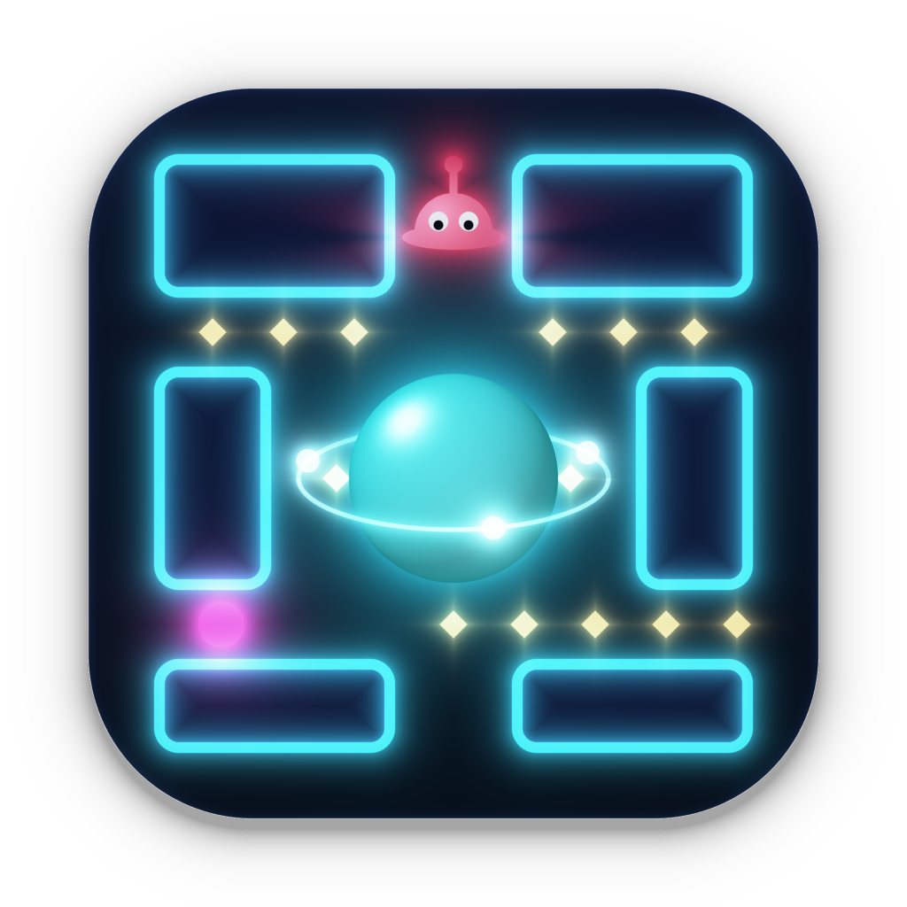

<p align="center">
  
</p>

<h1 align="center">Glowrunner</h1>

<p align="center">
  A 3D neon maze-chase game made in Unity 6.<br>
  You're a glowing orb collecting sparks across 99 mazes while four sentinel drones hunt you down.
</p>

## Download

Get the latest macOS app (universal: Apple silicon and Intel) from the [Releases page](https://github.com/lydianb79/Glowrunner/releases/latest).
Unzip it and double-click **Glowrunner.app**.

The app is not notarized by Apple, so macOS will block it the first time. Right-click it and choose **Open**, or go to
**System Settings ▸ Privacy & Security** and click **Open Anyway**.

## Controls

| Key | Action |
| --- | --- |
| Arrow keys / WASD | Move (you can press a turn early and it's taken at the next junction) |
| Space / Enter | Start, or continue after game over / victory |
| Left / Right (title screen) | Choose which unlocked level to start at |
| C | Switch between the chase camera and the overview camera |
| P / Esc | Pause |
| M | Music on/off (remembered between sessions) |
| ⌘Q | Quit |

There is basic gamepad support (left stick to move, A or Start to start), but it hasn't been tested much.

## Rules

- Sparks are worth 10 points. Collect them all to clear the level.
- Pink **power cores** (50) disrupt the sentinels for a few seconds. Ram disrupted sentinels for 200 → 400 → 800 → 1600.
  A captured sentinel flies back to its hangar to reboot.
- You start with 3 lives and get an extra life every 10,000 points.
- Your high score and the highest level you've reached are saved.

### The sentinels

| Color | Name | Behaviour |
| --- | --- | --- |
| Red | Tracker | Heads straight for you and speeds up when fewer than 20 sparks are left |
| Violet | Interceptor | Aims three cells ahead of where you're going |
| Green | Flanker | Comes straight at you while the Tracker is far away, otherwise moves behind you to cut off your escape |
| Amber | Wanderer | Roams to random spots, but locks on when you come within 5 cells |

Sentinels switch between *patrol* (each heads for its own corner) and *hunt* on a timer, and turn around whenever the mode changes.

## Levels

There are **99 levels**. Clearing level 99 shows the victory screen.

- **Level 1** is the hand-made maze. **Levels 2–99** are generated from fixed seeds (`MazeGenerator.cs`), so they're the same every time you play.
  Every generated maze is mirror-symmetric and fully connected, has no dead ends, and keeps the hangar in the middle and the start at the bottom.
  Some levels are tight with long corridors, others are open with many loops.
- Each level has its own neon color (10 colors in rotation).
- Difficulty ramps smoothly from level 1 to 99:

  | | Level 1 | Level 50 | Level 99 |
  | --- | --- | --- | --- |
  | Your speed (cells/s) | 4.6 | 5.3 | 6.0 |
  | Sentinel speed (cells/s) | 4.1 | 5.15 | 6.0 |
  | Power core disruption | 8 s | 4 s | 1.5 s |
  | Hangar wait | 100% | 51% | 25% |
  | Patrol phases | 100% | 70% | 40% |

- On the title screen, use Left/Right to start at any level you've already reached.

## Music and sound

Everything you hear is synthesized in code when the game starts. There are no audio files.

- **Title theme** (92 BPM): warm pads, soft bass and a gentle arpeggio.
- **Game theme** (128 BPM): pumping bass, a fast arpeggio, drums and a lead melody, in A minor.

The game track speeds up while sentinels are disrupted, sounds muffled while paused, and fades out when you're caught or clear a level.

## Building from source

Requirements: **Unity 6000.6.9f1** (other Unity 6 versions will probably work) with **Mac Build Support**. It uses the built-in render pipeline and no extra packages.

1. Clone the repo and open the folder in Unity Hub (**Add ▸ Add project from disk**).
2. The scene `Assets/Glowrunner/Scenes/Glowrunner.unity` opens automatically. Press **Play** to play in the editor.
3. To make the app, choose **Glowrunner ▸ Build macOS App** from the menu. It writes a universal app to `Builds/macOS/Glowrunner.app`.

From the command line:

```bash
/Applications/Unity/Hub/Editor/6000.6.9f1/Unity.app/Contents/MacOS/Unity -batchmode -quit -projectPath . -executeMethod Glowrunner.EditorTools.GlowrunnerSetup.BuildMacApp -logFile -
```

## How it's made

Everything (mazes, models, materials, lights, sound, music, HUD and even the app icon) is generated from code, so the project has no art or audio assets.

| File (`Assets/Glowrunner/`) | What it does |
| --- | --- |
| `Scripts/GameManager.cs` | Builds the world, runs the game states, scoring, lives and levels, and draws the HUD. If a scene has no GameManager, one is created automatically. |
| `Scripts/Levels.cs` | The 99 levels: layout per level, color theme and difficulty curve |
| `Scripts/MazeGenerator.cs` | Seeded maze generator and validator |
| `Scripts/Maze.cs` | The hand-made level 1 layout, grid helpers and BFS pathfinding (`#` wall, `.` spark, `o` power core, `P` player start, `-` gate, `S` hangar) |
| `Scripts/GridMover.cs` | Cell-to-cell movement shared by the player and the sentinels |
| `Scripts/PlayerOrb.cs`, `Scripts/Sentinel.cs` | The player and the enemy AI |
| `Scripts/Music.cs`, `Scripts/Sfx.cs` | The music and sound effects synthesizer |
| `Scripts/CameraRig.cs`, `Scripts/GameInput.cs`, `Scripts/Art.cs` | Camera, input (works with the old Input Manager and the new Input System) and material/primitive helpers |
| `Editor/GlowrunnerSetup.cs` | **Glowrunner ▸ Create Game Scene** and **Glowrunner ▸ Build macOS App** |
| `Editor/GlowrunnerIcon.cs` | **Glowrunner ▸ Generate App Icon**: paints the 1024×1024 icon and sets it in Player Settings |

### Tweaking

- **Difficulty and colors:** edit the curves and `Palette` in `Levels.cs`.
- **A level's maze:** change its seed or `Loopiness` in `Levels.cs`, or edit `Maze.DefaultLayout` for level 1.
- **Music:** edit the chord lists (`roots`) and the `melody` table in `Music.cs`.
